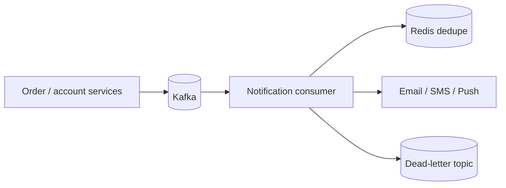

# EventPulse Notifications

A resilient notification-service reference implementation showing idempotent event intake, channel selection, controlled retries, dead-letter visibility, and operational endpoints.

## Engineering highlights

- Event IDs prevent duplicate delivery creation.
- Retry count and terminal dead-letter state are explicit domain concepts.
- Queryable delivery state supports support teams and replay tooling.
- Kafka and Redis development services are documented through Compose.
- Tests, Docker, CI, and Actuator are included.

## Target architecture



The runnable demo keeps state in memory to stay dependency-light. The Compose file and roadmap show the production evolution without pretending the demo already implements it.

## Run

```bash
mvn verify
mvn spring-boot:run
```

## Production roadmap

Kafka listener and producer adapters, Redis idempotency keys, exponential backoff, provider circuit breakers, WebSocket delivery updates, OpenTelemetry traces, and Kubernetes autoscaling.

## Author

[Sameer Khan Pathan](https://github.com/sameerkhan63731) · [LinkedIn](https://www.linkedin.com/in/sameer-khan-a2525041a)
